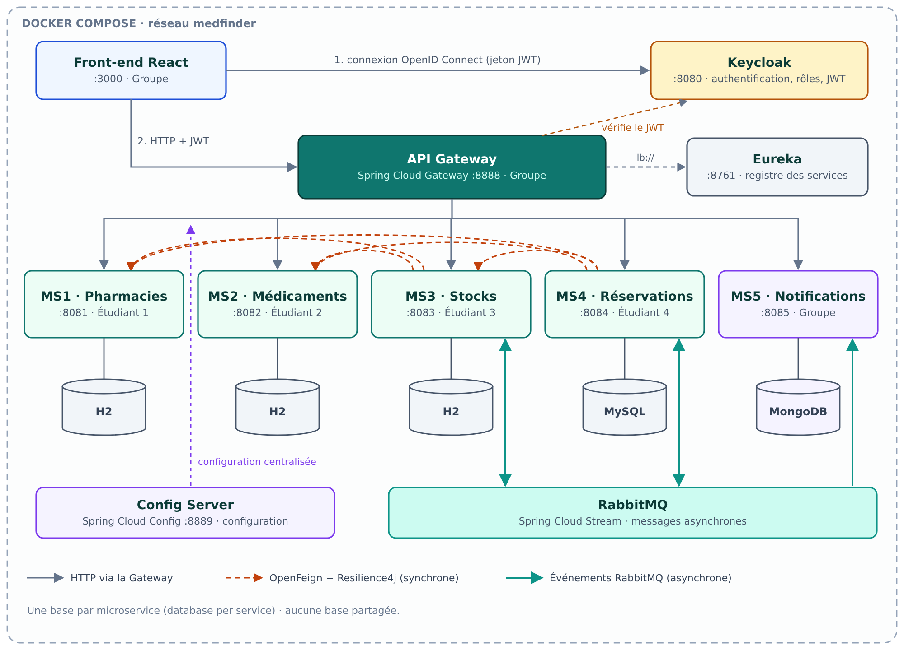

# MedFinder

> Trouver un médicament disponible dans une pharmacie proche, le réserver et être alerté de son retour en stock.

Mini-projet du module **AWD / MT-41 · Applications Web Distribuées** (2026-2027), architecture microservices.

## Équipe

| Membre | Microservice individuel | Partie commune |
|---|---|---|
| Jihed Khlifi | MS1 · Pharmacies (`pharmacy-service`) | API Gateway, Swagger |
| Abdelhamid Ayadi | MS2 · Médicaments (`medicine-service`) | Keycloak, sécurité |
| Ferdaouas Oueslati | MS3 · Stocks (`stock-service`) | Docker, RabbitMQ, pilotage MS5 |
| Insaf Makhloufi | MS4 · Réservations et alertes (`reservation-service`) | Eureka, Config Server |
| Toute l'équipe | MS5 · Notifications et statistiques (`notification-service`) | Microservice commun |

**Groupe :** Gen Z · **Classe :** 4DASI11 · **École :** ESPRIT

## Sujet

Un patient cherche un médicament : MedFinder lui indique les pharmacies proches qui l'ont en stock (prix, quantité), lui permet de le réserver avec un code de retrait, et le prévient automatiquement lorsqu'un médicament indisponible revient en stock. Les pharmaciens gèrent leur pharmacie, leurs stocks et les réservations ; l'administrateur valide les pharmacies, gère le catalogue et consulte les statistiques.

## Architecture



| Composant | Rôle | Port | Base |
|---|---|---|---|
| Frontend (React) | Interface web | 5173 | – |
| api-gateway | Point d'entrée unique, validation JWT, routage | 8080 | – |
| eureka-server | Découverte des services | 8761 | – |
| config-server | Configuration centralisée | 8888 | – |
| Keycloak | Authentification, rôles PATIENT / PHARMACIST / ADMIN | 8180 | – |
| pharmacy-service (MS1) | Pharmacies, gardes, recherche par distance | 8081 | H2 |
| medicine-service (MS2) | Catalogue, catégories, génériques | 8082 | H2 |
| stock-service (MS3) | Stocks par pharmacie, réservation d'unités | 8083 | H2 |
| reservation-service (MS4) | Réservations, alertes de retour en stock | 8084 | MySQL |
| notification-service (MS5) | Notifications, journal d'événements, statistiques | 8085 | MongoDB |
| RabbitMQ | Événements asynchrones | 5672 / 15672 | – |

**Communication**
- Synchrone (OpenFeign + Resilience4j) : MS3 → MS1, MS2 ; MS4 → MS2, MS1, MS3.
- Asynchrone (RabbitMQ) : `stock.replenished` (MS3 → MS4, MS5), `reservation.events` et `alert.triggered` (MS4 → MS5), `reservation.released` (MS4 → MS3).

Le détail (contrats d'API, diagrammes de classes, scénarios, gestion des pannes) est dans [`Documentation/Dossier_technique_MedFinder.pdf`](Documentation/Dossier_technique_MedFinder.pdf) et les diagrammes par microservice dans [`Documentation/Diagrams`](Documentation/Diagrams).

## Structure du dépôt

```
Backend/        un projet Spring Boot par service (config-server, eureka-server, api-gateway, *-service)
Frontend/       application React
Documentation/  Diagrams/, Presentation/, Dossier_technique_MedFinder.pdf
```

## Lancement

Prérequis : Java 17, Maven 3.9, Node 20, Docker Desktop.

**Tout lancer avec Docker** (fichier `docker-compose.yml` ajouté en semaine 9)
```bash
docker compose up --build
```

**Lancer un service seul (développement)**, dans cet ordre : `config-server`, `eureka-server`, puis les microservices, puis `api-gateway`.
```bash
cd Backend/pharmacy-service
mvn spring-boot:run
```

**Front-end**
```bash
cd Frontend
npm install
npm run dev
```

| URL | Usage |
|---|---|
| http://localhost:5173 | Application |
| http://localhost:8761 | Tableau de bord Eureka |
| http://localhost:8180 | Console Keycloak |
| http://localhost:15672 | Console RabbitMQ |
| http://localhost:8081/swagger-ui.html | Swagger de MS1 (8082 à 8085 pour les autres) |

## Gestion de projet

- Tableau GitHub Projects : [lien]
- Branche `main` protégée, une branche par fonctionnalité, fusion par pull request relue.
- Commits : `feat(ms3): ...`, `fix(gateway): ...`, `docs: ...`

## État d'avancement

- [x] Semaine 4 : conception validée, projets créés
- [ ] Semaine 5 : CRUD, Gateway, Eureka, Config Server
- [ ] Semaine 6 : OpenFeign, circuit breaker
- [ ] Semaine 7 : RabbitMQ, MS5
- [ ] Semaine 8 : Keycloak
- [ ] Semaine 9 : Docker, front-end
- [ ] Semaine 10 : démonstration finale
